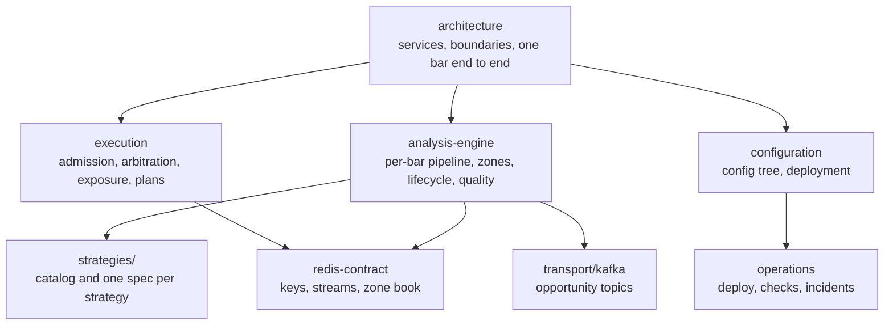

# ApexVoid docs

What the system is and how it decides. Measurement write-ups that led to a rule
are summarized in the rule's own page and the [CHANGELOG](../CHANGELOG.md); the
full historical audits are in the git history.

| Page | Read it for |
|---|---|
| [architecture](architecture.md) | who owns which decision; a closed bar from cTrader to the broker |
| [analysis-engine](analysis-engine.md) | how the Go engine turns bars into opportunities; zone validity; acceptance and quality |
| [strategies](strategies/README.md) | the twelve strategies, the shared confirmation spine, cross-strategy rules |
| [execution](execution.md) | how Algo Bot admits, arbitrates and publishes; exposure; TradePlan lifecycle |
| [redis-contract](redis-contract.md) | every Redis key, its writer and its readers |
| [transport/kafka](transport/kafka.md) | the opportunity event topics and delivery guarantees |
| [configuration](configuration.md) | `config/*.yml`, how production loads it, containment |
| [operations](operations.md) | deployment, routine checks, backups, incident response |
| [bot-commands](bot-commands.md) | Telegram commands and channel features |
| [security](security.md) | threat model and controls |
| [schema.sql](schema.sql) | PostgreSQL schema reference |
| [adr/](adr/) | boundary decisions that are not obvious from the code |

Diagrams are Mermaid and render on GitHub. When a diagram and the code disagree,
the code is right and the diagram is a bug.
