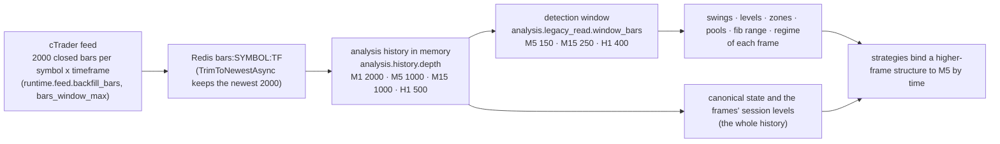

# Candle windows: feed, history, detection window, binding

How many closed candles the analysis reads, where each limit lives, and what each limit is allowed to cut. Written after the 30 Oct 2026 review that found three faults in how the windows were applied (see "What changed in v8").

| Frame | In memory | Detection window | Time the window covers |
|---|---:|---:|---|
| M5 | 1000 | 150 | 12.5 hours |
| M15 | 1000 | 250 | 2.6 days |
| H1 | 500 | 400 | about 3 trading weeks |

The feed is not the limit: it keeps 2000 bars per symbol and timeframe (M1, M5, M15, H1 are subscribed; the cTrader trendbar codec has no H4 or D1, so the `H4` and `D1` entries of `analysis.history.depth` are never filled).

## What the detection window is for

`window_bars` are the frozen Python lookbacks. Every swing, key level, zone, liquidity pool, dealing range and regime of a frame is detected on the last `window_bars` bars of that frame. That is deliberate and unchanged: widening the M5 window changes every M5 key level, trendline and flip, so it is only measured (below), never applied.

## What changed in v8 (30 Oct 2026)

1. **A structure found on M15 or H1 lives as long as its own frame holds it.** The strategies that find a structure on a higher frame (`fvg`, `order_block`, `supply`) bind it to M5 by time. Until v7 they dropped any structure whose origin was older than the first M5 bar of the 150-bar window, so an H1 zone from yesterday could never trade today. Now such a structure stays: its `OriginIndex` is -1 ("precedes the execution window"), its identity and `formed_at` come from the origin bar's time, its first touchable M5 bar is the first one opening at or after the close of the structure bar that completed it, and every quantity that used to be read from M5 bars after the origin (the leg or departure extreme, the leg of a gap) is read by time: the structure frame's own bars from the origin, plus the M5 bars since. A structure older than its own frame's window still drops, because the frame can no longer see it.
2. **Session levels come from the frame's whole in-memory history.** `legacyread.Stage` used to compute `frame.Sessions` from the 150-bar slice. At 08:00 UTC that slice starts at 19:30 the evening before, so "yesterday's high and low" were the extremes of 19:30-21:00 only, and a closed Asia/London/NY extreme could be cut the same way. They feed the zone score (session-level points) and the session-context factor of key_level, flip_zone, trendline and iFVG. The weekly levels now read H1's 500 bars instead of 400. Only finalized levels that were available at the frame's last bar are kept.
3. **History health is counted.** `analysis_history_short{symbol,timeframe}` counts evaluations in which a frame holds fewer bars than its window or than the largest lookback an enabled strategy declares (`*_window_bars`, `*_lookback_bars`); `analysis_history_gap{symbol,timeframe}` counts each hole inside the window once, outside the weekly closure (Friday 17:00 to Sunday 17:00 New York; no instrument declares a daily maintenance break). Both are Go counters in the engine's telemetry recorder; neither ever blocks an evaluation, and a holiday that closes the market longer than the weekend shows up as a gap.

## Frozen windows (parity)

The frozen-Python parity replays reproduce the old behaviour: `engine.WithFrozenWindows` (implied by `replaycapture.Options.WithoutStopBudget`) makes every frame take its session levels from its detection window (`WithFrozenSessionWindows`) and makes `fvg`, `order_block` and `supply` drop a structure older than the M5 window (`WithFrozenBinding`, the optional strategy parameter `bind_within_execution_window`, never set in `config/`). The four parity suites pass without regenerating any golden.

## Measured

See the pull request that introduced v8 for the tables (binding, sessions and the M5 window A/B); `test/candlewindows` regenerates them (`CANDLE_WINDOWS_REPORT=<file> go test ./test/candlewindows -run Measure`). They are publish counts, not P&L.

## Deferred

- Changing `window_bars.M5`: the owner decides from the A/B table.
- H4/D1: not in the feed; either add them or remove the dead `analysis.history.depth` entries.
