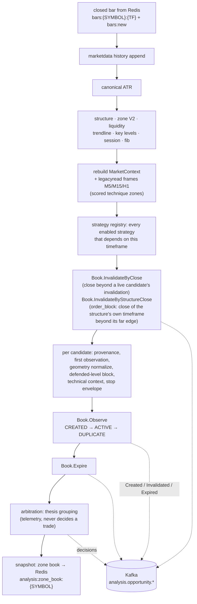
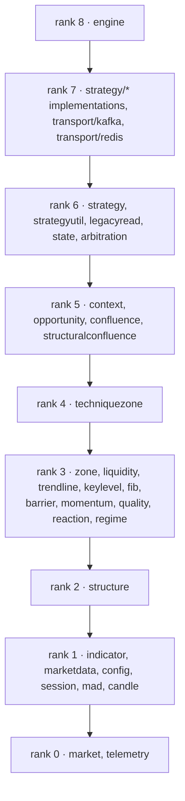
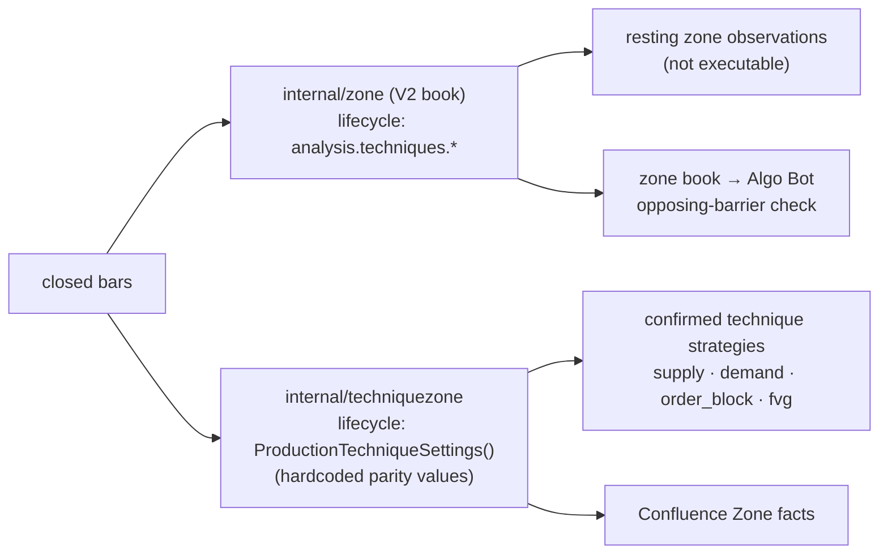
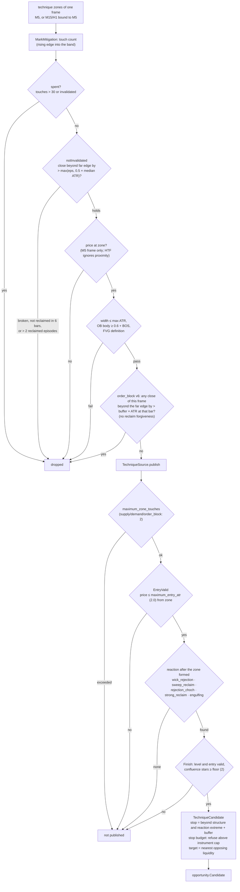
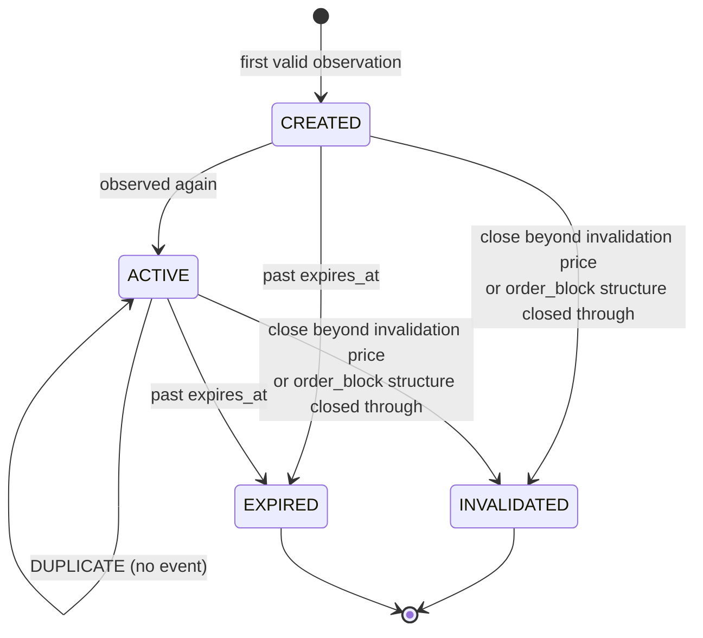
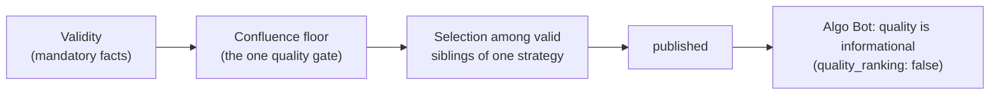

# Analysis Engine

The Go service in `analysis-engine/`. It reads closed bars from Redis, keeps the
technical state of every symbol, runs every strategy, owns each opportunity's
lifecycle and publishes that lifecycle to Kafka. It never sizes, routes or
executes a trade.

## One closed bar

`engine.SymbolWorker.ApplyWithResult` (`internal/engine/worker.go`) runs once per
closed bar, per symbol and timeframe, in this order:

Invalidation runs before the new observations, so a setup whose confirmed close
already broke its threshold cannot be re-observed on that bar. A close only
invalidates candidates observed on the same timeframe, except an `order_block`
structure, which only a close of the structure's OWN timeframe (M5, M15 or H1)
can withdraw ([order-block-definition](strategies/order-block-definition.md)).

## Packages

An arrow means "may import". A package imports only from strictly lower ranks;
the table in `analysis-engine/test/architecture/dependency_test.go` is the
authority and the test fails the build on a violation.
Strategies never import one another, Redis, Kafka, Postgres, Telegram, cTrader or
Algo Bot.

| Package | Role |
|---|---|
| `structure`, `liquidity`, `zone`, `trendline`, `keylevel`, `session`, `fib` | the canonical, causal technical state (V2 book) |
| `techniquezone` | the frozen-Python technique geometry (supply/demand, order block, FVG, iFVG, CRT) that the confirmed zone strategies trade |
| `legacyread` | bounded M5/M15/H1 frames with the detector swing algorithm, scored zones, pools and grabs, regime and HTF bias, derived from the same closed bars |
| `strategyutil` | the shared confirmation spine: technique source, reaction, `Finish`, stop budget, candidate builder |
| `opportunity` | candidate validation and the lifecycle book |
| `arbitration` | thesis grouping (`go_thesis_id`) and winner/suppressed/conflict telemetry |

## Two zone populations

The engine holds zones twice. Knowing which one a strategy reads matters when a
zone rule changes.

Changing `analysis.techniques.*` in `config/analysis.yml` changes the V2 book only.
The traded supply, demand, order block and FVG setups are judged by
`techniquezone.ProductionTechniqueSettings()` plus strategy-scoped keys injected in
`engine/technique_zones.go` (the FVG definition is the pattern to copy).

## Confirmed zone setups

The path every confirmed `supply`, `demand`, `order_block` and `fvg` opportunity
takes (`strategyutil.ConfirmedTechnique`):

A supply/demand zone that closed beyond its far edge but was reclaimed inside the
sweep window is still live: the reclaim counts as a liquidity sweep. **An order block
no longer is** (v6): any close of its own frame beyond the far edge by more than
`confirmed_break_buffer_atr` of that bar's ATR retires it, reclaimed or not; only a
wick that closes back inside is the sweep. The tolerance is measured
in the frame's median ATR over the 400-bar window, not the ATR of the breach bar.

## Opportunity lifecycle

Only CREATED, INVALIDATED and EXPIRED are published. A strategy that stops
emitting a candidate does not end it: a published opportunity lives until a
close beyond its own invalidation price (the stop level, not the structure edge),
for an `order_block` a close of its structure's timeframe beyond the structural
far edge (`STRUCTURE_CLOSED_THROUGH`), or until `expires_at` (formation time + the strategy's `expiry_hours`, 24 h for
the zone strategies). Algo Bot executes only opportunities that are live in this
book.

## Acceptance and quality

Three kinds of decision exist, and only one of them uses a quality number.

1. **Validity.** A failed fact rejects whatever the score: closed candles only and
   no look-ahead; the structure exists before the reaction
   (`Instance.TouchableFrom`, `ReactionFrom`); level and entry valid for the price
   (`LegacyDetector.Finish` runs `LevelValid`/`EntryValid` before scoring); the
   strategy's own formation; technical invalidation never tightened by the
   envelope; target room; `Candidate.Validate()`.
   `TestMaximalEvidenceCannotRescueAnInvalidSetup` pins the order.
2. **Confluence floor.** `Finish` refuses a valid setup below 2 stars
   (`legacy_detect.go`); iFVG, CRT and Break & Retest apply the same floor to
   their own factors, Confluence Zone to its independent-fact count. v1 factor
   points: HTF 4, touches up to 3, wick 3, displacement 3, session 2, structural
   3, fib 2.5, CHoCH 2 (of 20.5); 2 stars at 8, 3 at 12.
3. **Selection.** When one strategy has several valid candidates on a bar it
   publishes the one with more stars, then the nearest entry.

After Kafka, `quality.overall`, the stars and the tier change nothing: arbitration
ignores quality (`quality_ranking: false`), a confluence below the policy minimum
is a preference note, and volume does not depend on the tier
(`algo-bot/tests/test_quality_is_informational.py`,
`test_arbitration_neutral_ranking.py`). `Quality.Overall` is the mean of each
strategy's documented `score_*` dimensions in [0, 1]; replays found no positive
separation of outcome by it, which is why it does not rank.

## Strategy independence

Every strategy owns its candidates. Disabling one never changes another's, a
confluence overlap never removes a technique's setup (Confluence Zone publishes
its own opportunity beside theirs), and there is no strategy family in any
decision. Each strategy's execution profile is its own row in
`algo-bot/app/autotrade/strategy_catalog.py`; `strategy_family` on TradePlan V8 is
a record label no decision reads.

## Session and regime

Session is context and a confluence input, never a clock gate: no London/NY
window blocks a plan. The MAD Asia-phase classifier (accumulation, manipulation,
expansion) is soft context stamped onto opportunities.
