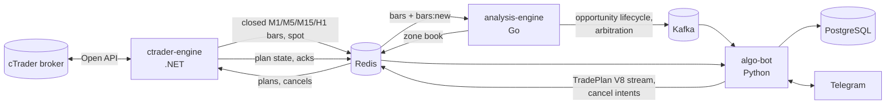
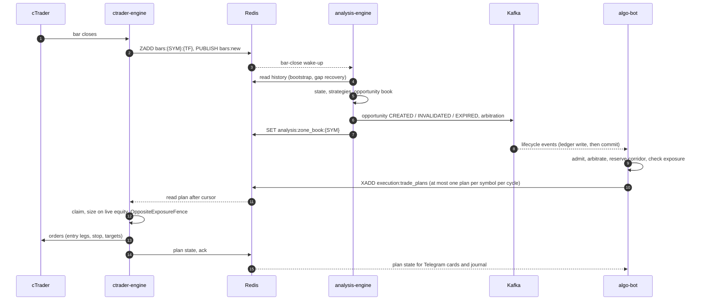

# ApexVoid architecture

ApexVoid is a self-hosted multi-symbol trading stack for cTrader. One service
owns each decision. The boundaries below are binding: giving a service a decision
listed under "must not own" is a boundary violation.

## System

| Component | Owns | Must not own |
|---|---|---|
| `ctrader-engine` (.NET) | cTrader auth and market feed, closed bars to Redis, broker account state, order and position lifecycle, SL/TP/BE, reconciliation, the final exposure fence | any technical judgement (zone validity, bias, liquidity quality, strategy confidence) |
| `analysis-engine` (Go) | indicators, structure, liquidity, zones, sessions, regime, every strategy, opportunity identity and lifecycle, thesis grouping, Kafka publication | account risk, exposure policy, Telegram, broker access |
| `algo-bot` (Python) | opportunity consumption, admission, same-thesis arbitration, entry-corridor reservation, exposure and risk policy, TradePlan construction, Telegram, journal, manual `/algo` | market structure, zones, detectors, scanning |
| Redis | closed bars, spot, zone book, TradePlan stream, plan state, cancel intents, locks and reservations | durable history |
| Kafka | the durable `analysis.opportunity.*` lifecycle | market data, execution traffic |
| PostgreSQL | opportunity ledger, plans, fills, results, journal, statistics | live trading state |

Python does not scan markets, rebuild zones or run detectors. A missing technical
fact is an Analysis Engine or contract defect, never a reason to recompute it in
Python. There is one configuration authority, `config/*.yml`
([configuration](configuration.md)).

## One closed bar, end to end

[Analysis Engine](analysis-engine.md) describes steps 4 to 6 inside the Go
service, [execution](execution.md) steps 8 to 12.

## Market-data plane and event plane

Redis owns operational market data: closed OHLC history, spot, bar-close
wake-ups, bootstrap and recovery ([Redis contract](redis-contract.md),
[ADR-010](adr/010-redis-market-data-kafka-events.md)). Kafka owns only durable
business events ([Kafka transport](transport/kafka.md)). There is no Kafka topic
for bars or ticks, and the engine keeps analysing from Redis when Kafka is down.

## Algo Bot

`app/analysis_client` decodes and persists the Kafka lifecycle. `app/autotrade`
holds admission, arbitration, exposure, TradePlan construction and event
handling. `app/bot` and `app/signals` are Telegram, the journal and the manual
workflow. `app/scalping` keeps outcome accounting only.

Manual `/algo` plans carry the plan-kind label `strategy_family=manual`, are
recorded as `algo_manual` and are exempt from the autonomous exposure rules: an
owner instruction is a direct decision, not analysis output.

## cTrader Engine

The executor claims a plan, sizes it against live equity and submits the declared
legs without recomputing entry, stop or targets. It honours cancel intents,
retires expired plans (cancelling resting legs, keeping filled exposure) and runs
`OppositeExposureFence` before the first broker mutation of a plan. It is the
only broker-facing service.

## Decisions

The ADRs in [`adr/`](adr/) record the boundaries that are not obvious from the
code: Kafka as the business-event boundary (004, partly superseded by 010),
centralized Go tests under `analysis-engine/test/` (006), shared contracts at the
repo root in `contracts/` (007), the Go Kafka client (008), at-least-once delivery
with idempotent consumers (009) and the Redis/Kafka split (010).
