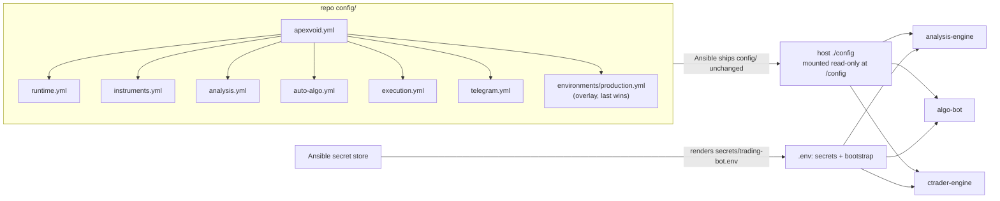

# Configuration

`config/*.yml` is the one non-secret configuration authority. `.env` carries
secrets and process bootstrap only. There is no second catalog, resolver,
profile system or generated manifest: each service loads the YAML tree directly
into its own small typed view.

## Files

`config/apexvoid.yml` is the production root and `config/apexvoid.demo.yml` the
optional demo root. `APEXVOID_CONFIG_FILE` selects one; Go, Python and .NET
resolve the same includes and the same environment overlay
(`config/environments/production.yml` or `demo.yml`).

| File | Holds |
|---|---|
| `runtime.yml` | service identity, Redis, Kafka topics and specs, feed, logging |
| `instruments.yml` | instrument packs and instruments: broker names, geometry, stop envelope, targeting, exposure policy, execution containment |
| `analysis.yml` | Go analysis inputs and every strategy's thresholds |
| `auto-algo.yml` | Algo Bot eligibility, lifecycle and risk policy |
| `execution.yml` | TradePlan and broker execution, manual workflow |
| `telegram.yml` | Telegram presentation, lifecycle and reports |



Every container gets `APEXVOID_CONFIG_FILE=/config/apexvoid.yml` from
`deployment-template/docker-compose.yml.j2`, so the repo's `config/` tree is what
production reads. Ansible also renders a legacy `config/trading-bot.yml` from its
group_vars; no service is pointed at it, so a strategy or analysis value set only
in ansible-library group_vars has no effect.

Secrets and bootstrap inputs (see `.env.example`): the Telegram, cTrader and
database credentials, channel and owner ids, `APEXVOID_CONFIG_FILE`, and the
`LOG_*` switches. A secret is never added to the YAML.

## Reachability

Every key must have a live consumer in Python, Go or .NET. A key nothing reads is
deleted, not left as a harmless default: dead keys read as policy and mislead
operators. Do not add a compatibility alias, a deprecated path or a translation
layer; rename the key everywhere in one change. When adding a field, update the
owning YAML file and its consumer together.

## Autonomous opposite-direction exposure

Each instrument (usually through its pack) owns one rule under
`exposure.opposite_position`; strategy names and scalp status are never
consulted.

| Instrument class | Config | Behavior |
|---|---|---|
| FX (EURUSD, GBPUSD, GBPJPY, USDJPY, any new pair) | `allowed: false` | any opposite exposure on the symbol blocks the plan at any distance (`fx_opposite_position_not_allowed`) |
| XAU (`XAU`, `XAUUSD`, `GOLD`) | `allowed: true`, `minimum_separation_pips: 150` | the entry must be at least 150 pips (inclusive; `pip_size` 0.1, so 15.0 price) from EVERY existing opposite group, else `xau_opposite_position_too_close` |

A missing or invalid policy fails closed in both Algo Bot and cTrader Engine.
Manual `/algo` plans are exempt (owner instruction).

## Execution containment

An instrument can observe a strategy without trading it:
`instruments.<SYMBOL>.overrides.execution.go_opportunity.observe_only_strategies`.
Analysis stays on, so the opportunity is produced, stored and decided with reason
`execution_contained`, but no TradePlan is built from it. Removing a name
re-enables execution; nothing else changes. Current containment is documented
with its evidence in [strategies](strategies/README.md).

A structure timeframe can be contained the same way:
`...go_opportunity.observe_only_structure_timeframes`. Both lists are empty on every
instrument (owner rule 2026-10-14: every strategy and structure timeframe trades). Go publishes the timeframe a
setup's structure was built on as the typed `structure_timeframe` field of
`analysis.opportunity.v1` (omitted when it equals `timeframe`), and the same two
leaves are enforced twice: when the opportunity becomes a match, and again at
plan admission, so a match stored before a containment change cannot become a plan.

For the zone family (`supply`, `demand`, `order_block`, `fvg`) Go also publishes an optional, display-only
`structure: {timeframe, low, high, formed_at}` block on `analysis.opportunity.v1`: the whole structure on its own
timeframe (M5, M15 or H1), not the execution band in `entry`. The root card prints it as
`Structure: FVG M15 · 4,152.30–4,154.40 · formed 14:15 UTC` (plus `Order zone: low–high` when the order is placed on
a different band). No policy, identity or statistic reads it; an event without it renders as before. See
[fvg](strategies/fvg.md).

`analysis.strategies.demand` carries
`higher_timeframes: [M15, H1]`: those frames' own zones are also evaluated against the
M5 closed bars, judged on their own frame's bars and ATR, confirmed and executed on M5
(see [HTF zone structure](strategies/htf-zone-structure.md)). Removing the key restores
M5-only evaluation. `fvg`, `order_block` and `supply` (v7) own their mechanism and name their frames with `structure_timeframes: [M15, H1]`
(M5 only confirms and executes); their whole blocks are documented in [fvg](strategies/fvg.md), [order_block](strategies/order_block.md) and [supply](strategies/supply.md).

## Sessions

Session is analysis context and a quality input, never a clock gate: no
London/NY or kill-zone window blocks a plan on any instrument. XAU earned most of
its profitable week outside the London/NY opens (Asia +1240 pips, London +296,
NY +1569), so a hard session gate would remove edge.

## Validation

```bash
docker compose config -q
PYTHONPATH=algo-bot python config/scripts/resolve_reference.py --all
```

The loaders reject malformed roots, include cycles, missing required sections and
invalid instrument declarations.
