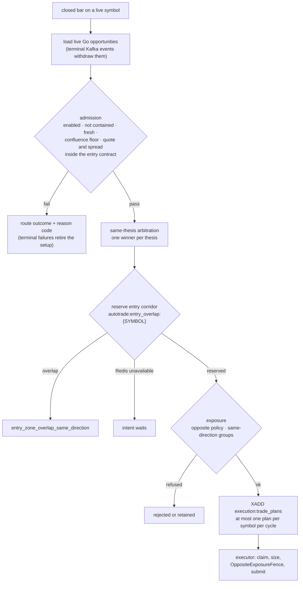
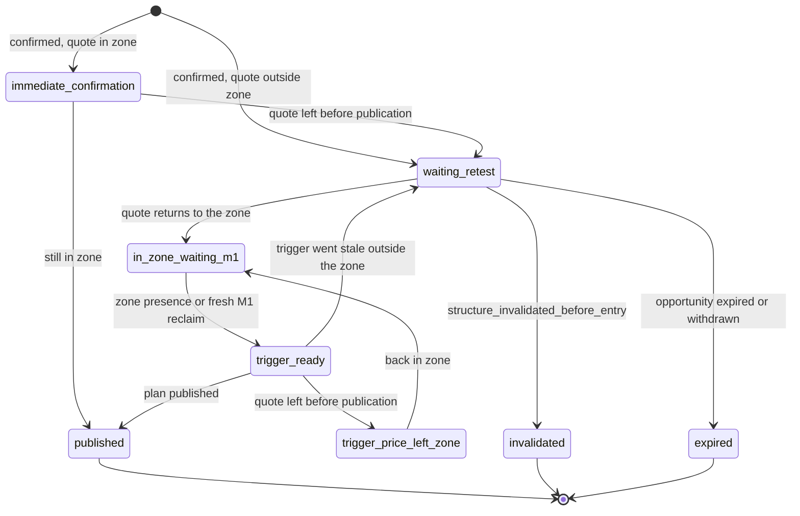
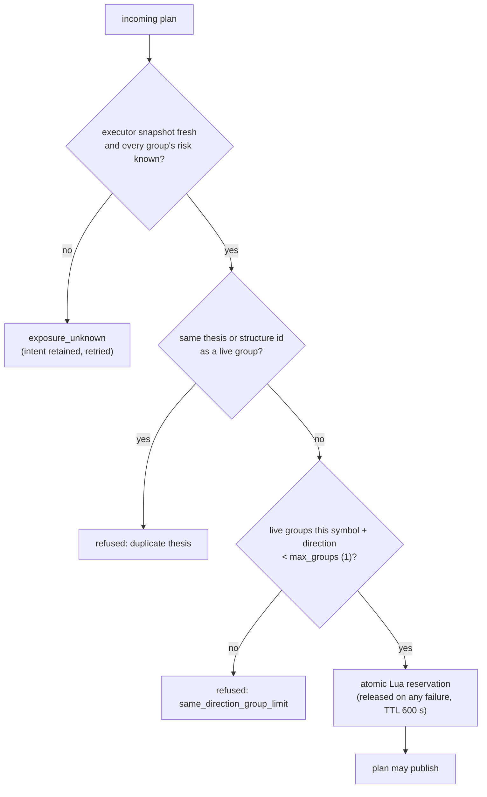
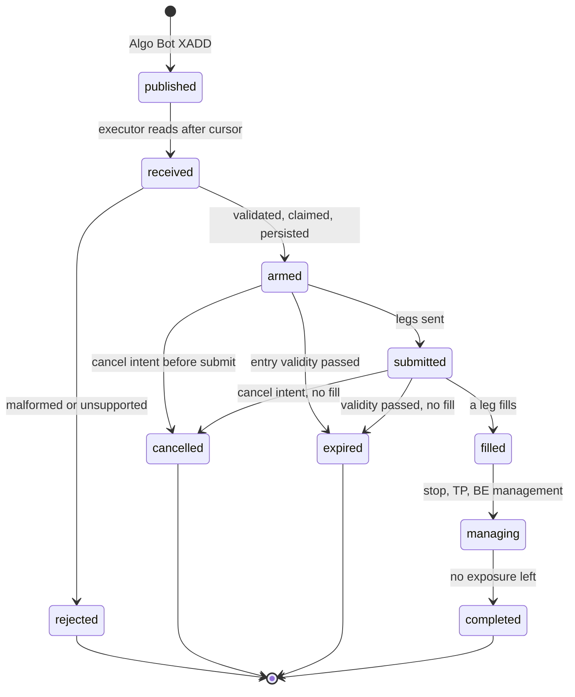

# Execution

TradePlan V8 is the only execution contract. Algo Bot declares one complete,
versioned plan (exact entry instruction, absolute stop, absolute targets) and
cTrader Engine executes it without recomputing any of it. Autonomous setups and
owner-armed manual `/algo` signals travel the same path. When ownership or
exposure evidence is uncertain, execution fails closed.

## One closed bar, one decision cycle

For every closed bar of a live symbol, Algo Bot:

1. **Loads** the live Go opportunities of the symbol (adapted from
   `analysis.opportunity.v1`; terminal events withdraw them).
2. **Admits** each one: not already terminal or published, auto trading and the
   strategy enabled, instrument not observing the strategy or its structure timeframe (`observe_only_strategies`, `observe_only_structure_timeframes`; checked at match creation and again here),
   fresh and not expired, confluence at or above the global floor (not applied to the
   scalp lane, whose strategies have no zone reaction to score and judge themselves), quote and
   spread inside the entry contract. A failure records a route outcome with a
   reason code; terminal failures also retire the setup.
3. **Arbitrates** the admitted intents ([below](#same-thesis-arbitration)).
4. **Publishes** at most one TradePlan per symbol per cycle, trying the ranked
   winners in order and falling back only when a winner is terminally rejected.
5. The executor re-checks exposure and submits.

### Same-thesis arbitration

Strategies stay independent, so several can fire on one idea in the same cycle.
Intents on the same symbol and direction compete for one executable thesis when
they share a Go thesis group (`go_thesis_id`), the same structural id, or entry
zones that overlap after a one-ATR pad. One winner per thesis is published; the
rest are suppressed with `same_thesis_suppressed`.

The winner is chosen by a fixed hierarchy, with no strategy favouritism:

1. execution eligibility (the quote can enter the entry contract now);
2. freshness of the confirmation;
3. intent id, as the deterministic tie-break.

With `actionability.scanner_gates.quality_ranking: false` (the committed setting) no quality score is part of the order. A
2026-10-15 offline replay found no measurable difference in outcome between the quality order and an order that uses no score,
and no relation between the score and the outcome; the cost of dropping it is more held direction conflicts, not lost edge.
Setting it to `true` restores the earlier order: strategy quality (Go `quality.overall`), confluence, structural/source quality,
then freshness and id.

Opposite directions never share a thesis. When BUY and SELL intents are both
executable, the pair is held (`opposite_direction_conflict`) unless exactly one
direction agrees with the higher-timeframe bias. (With `quality_ranking: true` the direction
whose best intent leads by `conflict_margin_quality` wins before the bias is consulted.)

### Atomic corridor reservation

The winner reserves its entry corridor in one Redis script
(`autotrade:entry_overlap:{SYMBOL}`) before anything is published, and holds it
for 45 minutes whether or not the position is still open. A later same-direction
intent whose corridor overlaps is rejected (`entry_zone_overlap_same_direction`),
which also closes the stop-out re-entry hole. The script reads, decides and
writes in one round trip, so two workers cannot both conclude they own a
corridor. If Redis cannot run it the intent waits (`entry_zone_reservation_unavailable`);
it never publishes unreserved.

### Ownership and duplicates

- `auto_trade:cycle_route_lock:{SYMBOL}:{cycle_id}` serializes evaluation of a
  cycle's ranked list; `auto_trade:route_lock:{SYMBOL}:{match_id}` stops two
  workers evaluating the same match. Both use random owner tokens, a finite TTL
  and compare-and-delete release.
- `auto_trade:cycle_owner:{SYMBOL}:{cycle_id}` records the winner, so a duplicate
  event delivery cannot replace it.
- `route_in_progress`, `cycle_conflict`, `duplicate_reaction`, `duplicate_thesis`
  and `publication_unavailable` preserve the preferred route and block lower
  intents; only an intent-specific `terminal_reject` permits fallback.
- A thesis claim allows one autonomous initial plan per thesis.
- The plan id is derived from the match id and `execution:plan_dedup:{plan_id}`
  tombstones publication, so a retried publish, a redelivered Kafka record, a
  consumer restart or a Redis reconnect cannot create a second plan. The Kafka
  consumer writes the match idempotently and commits only after the ledger write.
- The executor claims each plan once and persists state, so a process restart
  resumes work instead of resubmitting.

## Waiting for the entry

A confirmed opportunity whose quote is outside its executable entry zone is not
dropped. It waits, and fills when price returns, for as long as the opportunity
is live in Go's book.

`structure_invalidated_before_entry` fires only when the quote passes the
opportunity's stop level (`structure_swing`). A zone that price closed through
without reaching the stop does not end the wait; only Go's invalidation, its
expiry (24 h for the zone strategies) or a withdrawn id does
([lifecycle](analysis-engine.md#opportunity-lifecycle)).

## Exposure

Opposite-direction exposure is decided per instrument from `instruments.yml`
(`exposure.opposite_position`) and by the INCOMING trade's exposure lane. The lane is
the Algo Bot catalog's (`strategy_catalog.exposure_lane`): `scalp` for a strategy whose
profile carries the `m1_scalp` trait (today Impulse Pullback Scalp, Range Scalp and Impulse Retrace Scalp), `standard` for
everything else and for a name outside the catalog. The lane of the groups already open
does not matter. Strategy names are never consulted.

| Instrument | Incoming standard trade | Incoming scalp-lane trade |
|---|---|---|
| FX (EURUSD, GBPUSD, GBPJPY, USDJPY) | any opposite exposure blocks the plan at any distance (`fx_opposite_position_not_allowed`) | the same: FX never allows an opposite position |
| XAU | entry at least 150 pips (inclusive) from every opposite group (`xau_opposite_position_too_close`) | entry at least 80 pips (inclusive) from every opposite group (`xau_scalp_opposite_too_close`); owner decision 2026-11-03 |

`scalp_minimum_separation_pips` is required when `allowed: true` (positive, not above
`minimum_separation_pips`) and forbidden when `allowed: false`; both parsers (Python
`OppositePositionPolicy`, C# `OppositePositionPolicy.Parse`) refuse a config that breaks
this. The lane travels on the plan as the optional `exposure_lane` field of TradePlan V8
(absent means `standard`, so plans published before the field existed parse unchanged); the
executor fence reads it and refuses an unknown value (`opposite_exposure_lane_unknown`).
**Deploy order: Python and cTrader together, or cTrader first** (it accepts the field
before anyone sends it); a Python-first deploy would send a field an older executor
ignores, which would then apply 150 pips to a plan Python admitted at 80.

With XAU `pip_size` 0.1, a BUY at 4300.0 blocks a SELL at 4314.9 and allows one at
4315.0; an Impulse Pullback BUY at 4300.0 is allowed a SELL from 4308.0 (80.0 pips).
A missing or invalid policy fails closed: Algo Bot rejects with
`opposite_exposure_policy_unavailable` and the executor refuses the order.
Algo Bot (`evaluate_opposite_exposure`) and the executor (`OppositeExposureFence`,
run before the first broker mutation of a plan, against tracked plan state plus
real broker positions and pending orders) enforce the same rule independently.
Same-direction stacking is a separate rule: every instrument admits one group per
direction at a time (`exposure.same_direction.max_groups: 1`; `app/autotrade/group_exposure.py`).
The opposing-STRUCTURE gates (the Go zone book: `opposing_entry_overlap`, `opposing_entry_contained`,
`opposing_major_no_room`) are skipped for the same lane (`strategy_taxonomy.match_bypasses_opposing_structure`);
the scalp is judged on its own native room instead. The same-direction rule and `thesis_already_owned` are
not lane rules and apply to scalps unchanged.
Principle: one failing structural thesis must not silently become several correlated
account losses. It came from the 12-13 October 2026 USDJPY incident (four same-thesis
SELLs open together and stopped together) and the XAU record before it (groups that
entered on top of an open same-direction group averaged -0.39R against -0.09R alone).

A group counts from pending until fully closed, including after TP1 or break-even.
An XAU scale-in ladder is one group. Unknown is never zero: a stale snapshot, an
unreadable runtime state or a recovering group refuses with `exposure_unknown` and
the intent is retried. Manual `/algo` groups count as exposure but are never refused.
Rollback: remove the `same_direction` block from the instrument packs.

## Expiry and cancellation

A plan past its entry validity expires in the executor; one whose opportunity is
invalidated or expires gets a durable cancel intent from Algo Bot
(`execution:plan_cancel:{plan_id}`, a tombstone written even before the plan
exists). The executor honours either before submitting anything:

| Stage | Result |
|---|---|
| not yet submitted | never sent; plan cancelled |
| resting orders | every unfilled leg cancelled at the broker |
| partially filled | unfilled legs withdrawn; filled legs keep their stop and TP/BE management |
| open position | never closed by a cancel or an invalidation |

A plan with no exposure left retires. A cancel the broker answers with
`ORDER_NOT_FOUND` cannot succeed on retry, so the leg is resolved from the live
positions: a position carrying its client order id is adopted as a fill,
otherwise the leg is written off as already gone.

## Entry, stop and targets

- **XAU** scales in over three prices (owner decision 2026-11-06): 60% / 20% / 20% of the volume. ZL-1 (the entry zone and the ladder prices):
  - **The zone is the zone the engine found.** A non-scalping XAU opportunity needs an entry zone of at least **30 pips** (3.00 price units: `pip_size` 0.1, read from
    `instruments.yml` `stop_envelope.min_entry_zone_width_pips`, never assumed). The engine refuses a thinner one at publication (`entry_zone_below_minimum_width`,
    counted in `strategy_refused`) and Algo Bot refuses it again as a second line (the same code, in the plan-build rejection). Nothing stretches a thin zone toward the
    stop any more and the invalidation never moves to make room (the old `_execution_entry_zone` widened it to 30 pips, 50 for Break & Retest, and moved the stop out
    by the same distance). A zone wider than 50 pips is trimmed to its 50 pips nearest the near edge; a stop-budget cut band keeps 30 pips
    (`deep_entry_minimum_width_pips: 30`) or the strategy refuses. A scalp (`impulse_pullback`, `range_scalp`, `impulse_retrace`: the strategy's own declared kind) may
    enter at one price and is exempt; FX is unchanged.
  - **The ladder is price legs that are really different.** The legs start at the proximal edge, or at the live quote once price is inside the zone (never above the
    quote for a BUY: a leg priced through the market is not a resting order), and spread to the zone's far edge (`xau_ladder.price_ladder`; 4300.00-4303.00 gives
    4303.00 / 4301.50 / 4300.00). Every neighbouring pair is at least `execution.xau_ladder.min_leg_spacing_pips` (10 pips = 1.00) apart, **judged after rounding** to
    the broker's digits and again after the card snaps the prices; where three prices do not fit, two (60/40) do; where not even two fit (a quote near the far edge, a
    zone price has gone through) the plan is refused with `ladder_geometry_unavailable`: no repeated price, no widened zone, no push outside the structure, no market
    legs, no larger risk, no silent single entry. The plan declares the spacing it checked in `entry.min_leg_spacing`, the executor re-checks it on receipt, and the
    risk leg is dropped (the ladder kept) when it would sit within that spacing of an entry leg. Manual `/algo` uses the same builder and spacing; a single typed price
    stays the owner's single price.
  - **The executor does not turn a ladder into one price.** Before each leg after the first it re-checks the quote (a stale quote pauses the ladder until the next
    poll), then a LIMIT leg (every `market_with_limit_scale` L2+, every `limit_ladder` leg after L1, the risk leg) must be a real resting order: a BUY limit at most
    `max(spread, tick)` below the ask (a SELL limit above the bid), and at least the declared spacing from every sibling already submitted or filled (at its real
    fill price). Otherwise the leg is **skipped** (`skipped:limit_leg_marketable` / `skipped:leg_price_collides_with_sibling` on the leg, a `leg_skipped` event) and never
    submitted at another price or with its size moved; a restart never submits a skipped leg; a plan whose every leg was skipped is rejected
    (`all_ladder_legs_skipped`). Broker gaps and slippage can still produce actual fills at nearly the same price from distinct limits: these are the strongest
    feasible live checks, not an absolute fill guarantee. A volume too small to give every leg the broker minimum keeps as many legs as it can fill (`trade_plan_builder`). The structure stop is held to the
  50-70 pip envelope, targets are 1R/2R/3R/4R closing 40/20/20/20 with
  break-even after 1R, and unfilled legs are cancelled after TP. The optional
  XAU risk leg (0.02/0.05 lots by equity, 15 pips inside the stop) is declared
  by the planner in `entry.risk_leg` (the Auto Algo root card does not print it);
  the executor places exactly the legs the plan declares and never adds one
  (production 2026-10-08: an executor-injected leg the plan did not hold).
  `execution.reaction_risk_leg` holds its switch and sizing table, read by the
  planner; technical provenance never changes the leg set. Manual `/algo` uses the same XAU ladder and the same risk sizing as the Auto Algo (owner decision
  2026-11-06; `xau_ladder.price_ladder`, `manual_plan.py`): the owner's zone is the ladder's span, a single-price zone runs toward the stop and never past halfway to
  it, and non-XAU manual ladders keep the 80/20 shallow/deep split. FX manual plans are single-entry and take the FX 2% risk sizing.
  **An XAU setup never enters its full volume at one price** (owner rule 2026-11-06): the ATR minimum (`zone_scaling.fill_min_atr`) does not refuse the split, and an
  in-zone market preference becomes market L1 plus limit L2 and L3 deeper, each at least the minimum spacing apart. ZL-1: when the zone cannot hold those prices the plan is
  refused (`ladder_geometry_unavailable`) rather than collapsed into one entry; the only way back to a single entry is switching `zone_scaling.fill_enabled` off.
  Because the plan is multi-leg, it carries the risk leg. FX stays single-best-entry; M1 scalps stay single-market.
  **XAU is sized by risk that follows equity** (owner decision 2026-11-06, `sizing.risk_percent_by_equity` in the XAU pack): 5% of equity per trade from $500 to $5,000,
  tapering linearly to 2% at $6,000 and 2% above; below $500 the owner equity table still applies. The percent is the total loss at the stop: the planner subtracts
  the separately-sized risk leg's own loss (15 pips from the stop x its fixed lots) from the budget, publishes the remainder as `risk.risk_percent` with
  `sizing.mode: risk`, and the executor sizes the 60/20/20 entry ladder as budget / (stop pips x pip value per lot), floored to the broker step. The risk leg keeps its
  fixed lots and is placed as its own order; a volume too small to give every entry leg 0.01 lot keeps as many legs as it can fill.
  `contracts/autotrade/xau-ladder-spec.json` pins the risk leg and the legacy two-leg prices.
- **The card price is the order price.** Every price on a card (entry zone,
  stop, targets, risk leg) is what the plan holds and the executor places. A
  setup enters only with the quote inside the card's zone (plus the contract
  tolerance); past the edge it waits for a retest and never chases at the quote.
  Impulse Pullback keeps its bounded momentum chase.
- **FX** takes one precise entry per plan with 1R/2R targets closing 50/50 and
  break-even after 1R; the stop envelope is per pair (EURUSD 12-20 pips,
  GBPUSD 15-25, GBPJPY 22-35, USDJPY 18-28).
  **FX is sized by risk, 2% of equity per trade** (owner decision 2026-11-06, `sizing: {mode: risk, risk_percent: 2.0}` in both FX packs): the executor sizes
  lots = equity x 2% / (stop pips x pip value per lot), with the stop measured from the worst entry price to the plan's stop, floored to the broker step (never rounded
  up). EURUSD and GBPUSD use $10 per lot per pip, USDJPY and GBPJPY their `contract.pip_value_per_lot`. Before this, FX used the equity table x 1.5 (0.18 lot at
  $1,000-$2,000), which risked 1.6-3.7% depending on the stop. XAU keeps the equity table; scalps keep their own sizing. The plan's `risk.risk_percent` and
  `sizing.mode` carry the rule, so a card shows what the executor will use.
- **Scalps** (`impulse_pullback`, `range_scalp`, `impulse_retrace`) keep their own M1 stop book and ladder; XAU-only.
  **The scalp stop is capped at 40 pips** (SCALP-R40; `auto_algo.strategies.scalping.stop`: minimum 30, maximum 40). 40 is a hard eligibility limit on the planned stop,
  measured from every planned executable leg (the worst entry included) to the absolute SL at broker precision: not a target distance and not a risk percentage.
  Go applies it three times over the one config leaf: each detector refuses a structure (uncompressed, with its buffers) wider than 40 from its worst entry and widens a
  narrower one to 30; the stop envelope attached to the opportunity is the dedicated 30-40 `scalp_stop_envelope`, never the XAU 50-70 instrument envelope; and Algo
  Bot enforces it again whatever envelope arrived (`stop_bounds_scalp_hard_capped_pips`): an envelope published under an older cap, or none, cannot lift it. A stop that
  does not fit is refused (`stop_exceeds_go_invalidation_envelope` with `furthest_leg_stop_pips`, or `scalp_stop_exceeds_hard_cap` from the final per-leg guard),
  never compressed, and a stop that only crosses the cap when rounded to the tick is refused too (`go_invalidation_over_max_after_rounding`). A quote that moved after
  the detector (a chase, a deeper retrace) is re-measured when the plan is built: the planned entry is the live quote, so a chase that lengthens the stop past 40 is
  refused, and one that moves toward the stop widens it outward to 30 at most, never inward. The plan's `entry.max_slippage_ticks` is the headroom the cap leaves
  above the planned legs (not the generic 10, or 100 for a chase), and the executor already waits (`slippage_exceeds_declared_limit`) instead of sending a market leg
  whose live quote is worse than that, so the cap is re-checked against the quote at submission. Volume, the 0.5% scalp risk setting, targets (1R/2R), break-even,
  the manual and auto ladders and Tricky Leg are unchanged; a lower cap can only lower the largest stop a scalp can carry. A stop order can still fill beyond its price in a market
  gap: this is a cap on the planned stop, not a guaranteed maximum realized loss.

## Operator controls

`/trade_close`, `/trade_close_auto`, `/trade_sl`, `/auto_close_all` and
`/trade_cancel` act on the plan runtime: closes and stop moves go through the
executor, cancels through the cancel intent. The owner pause
(`auto_trade:paused`) holds new submissions.
