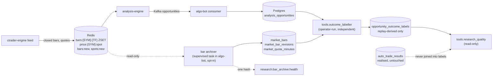

# Research data foundation: durable bars and forward outcome labels

**Status: built, verified locally, not installed.** Nothing here runs in production until an operator enables it (see [Rollout](#rollout)). Nothing here
is a quality model, changes a detector, a gate, sizing or execution, or enables `quality_ranking` (it stays `false` in the Go engine and Algo Bot).
It exists so that every Go opportunity, executed or not, can later be judged against the bars that followed it.

Why: of 9,820 opportunities published since 22 Oct only 278 became trades with a net R, and Redis keeps about 5 days of M5 and 33 hours of M1. No
question about unexecuted opportunities (quality bands, gates, strategy changes) could be answered. Two pieces fix that: a durable bar and quote
archive, and an independent labeller that replays each opportunity's immutable geometry on those bars.

## Architecture and data flow

- **Reused services.** The archiver is one more read-only consumer of the Redis plane that the Go engine and Algo Bot already read, running inside
  the existing algo-bot process and writing to the existing Postgres through the same pool. No new service, container, topic or storage engine.
- **Authority.** Go still produces every opportunity and every score. The archiver stores what the feed published; the labeller reads an
  opportunity's published geometry. Neither computes a technical fact and neither feeds anything back into trading.
- **Code.** `algo-bot/app/research/` (`bar_store`, `bar_archive`, `outcome_model` (pure), `outcome_store`, `quality_report` (pure)) and three tools:
  `tools/research_data.py`, `tools/outcome_labeller.py`, `tools/research_quality.py`.

## Schema

Created on demand by `python -m tools.research_data init-schema` or by the archiver's first start; **not** by `init_db`, so deploying this code with the
archive disabled creates nothing. Reference DDL is in [schema.sql](schema.sql).

| Table | Key | Holds |
|---|---|---|
| `market_bars` | (symbol, timeframe, open_ts) | the feed's closed bar exactly as published: open_ts (bar OPEN, epoch s), OHLC, tick volume, `ohlc_hash`, `source` (`ctrader-feed/redis-zset`), `ingest_path` (`live` / `catchup` / `backfill`), `normalized` (legacy price scale applied), `revisions`, `first_seen_at` |
| `market_bar_revisions` | (symbol, timeframe, open_ts, revision) | the superseded values of a bar the feed re-published with different values |
| `market_quote_minutes` | (symbol, minute_ts) | per UTC minute: `quote_count`, last bid/ask, min/max/mean spread (price units) |
| `opportunity_outcome_labels` | (opportunity_id, label_set) | the replay label: geometry, strategy, quality score, model version and components, config fingerprint, thesis key, fill state, outcome, R bounds, touch timeline, ladder view, spread source, data quality, completeness, assumptions |

Timeframes: M1, M5, M15, H1 (what the engine reads); H4 is derived from H1 and not stored. Symbols: XAU, EURUSD, GBPUSD, GBPJPY, USDJPY.
Data completeness is explicit: a minute's `quote_count`, a bar's `ingest_path`/`revisions`, a label's `spread_source` and `data_quality`, and gaps are counted, never filled.

**Retention** (`runtime.market_data_archive.retention_days`, deleted once a day by the archiver and by `tools.research_data prune`): M1 180, M5 730,
M15 730, H1 1825, quote_minutes 180, outcome_labels 730. `prune --dry-run` prints what would go.

## Persistence guarantees

| Property | How |
|---|---|
| Idempotent | upsert keyed by (symbol, timeframe, open_ts); an identical bar is left alone, a different one is revised in place and the old values kept. Re-reading a whole window changes nothing (verified: 0 inserted, 2000 unchanged). |
| Restart-safe | a notification is only a hint. On start and every `reconcile_interval_seconds` each series is read from its last stored bar on; once an hour the whole Redis window is re-read (catches revised bars). Nothing depends on remembering a message. |
| Gap-detecting | gaps between stored bars are split into scheduled closures (daily break 17:00-18:00 New York, weekly closure Fri 16:58 - Sun 18:00, observed on the live feed on both sides of daylight saving) and **unexplained** missing bars; the latter are logged once, counted in the health record and make `status` exit non-zero. A gap is never filled. |
| Bounded buffering | the buffer is the set of dirty (symbol, timeframe) pairs, at most symbols x timeframes by construction; quotes are folded into at most `max_open_quote_minutes` (40) open minutes, beyond which the oldest is dropped and counted (`quote_minutes_dropped`). |
| Failure handling | a failed pass keeps its dirty set, counts the error, marks the state `degraded`, and retries with doubling delay (capped at 60 s); the first failure logs a traceback, later ones one line. Redis blips are retried by the existing supervisor. Verified: Postgres stopped mid-run, a bar published meanwhile, Postgres restarted: state back to `running`, bar stored. |
| Refuses, never repairs | an OHLC-inconsistent bar or a malformed member is not stored and is counted (`refused_bars`). |
| Monitoring | Redis hash `research:bar_archive:health` (state, consecutive errors, last error, per-series last bar and lag, rows written/revised, dirty series, open quote minutes, unexplained gaps). `python -m tools.research_data status` prints coverage and exits 0 healthy / 1 unhealthy / 2 never ran. |

## Storage and resource estimate

Measured on the real schema (local Postgres 17, 4,400 real XAU bars; production database today: 354 MB):

| Item | Measured | Rows per day (5 symbols, calendar-day average) | Steady state with the default retention |
|---|---|---|---|
| `market_bars` | 235 B/row incl. index | about 6,300 | about 2.0 M rows, **about 0.47 GB** |
| `market_quote_minutes` | 175 B/row | about 4,900 | about 0.89 M rows, **about 0.16 GB** |
| `opportunity_outcome_labels` | about 3 KB/row (JSONB components and assumptions) | about 550 (all strategies, one label set) | about 0.4 M rows, **about 1.2 GB** |

Total about **1.8 GB at steady state** (about 0.5 GB/year of growth before pruning bites, plus about 0.6 GB/year of labels). The VPS has 77 GB free.
Operational cost: no new process; about 20 Redis `GET` a second at most (quote sampling, 250 ms feed throttle), one incremental read per series
every 2 minutes and a whole-window read (about 22 k small JSON members across 20 series) once an hour; a handful of Postgres statements a minute. The labeller is a batch job
you start (it reads one opportunity's bars at a time).

## Gap recovery behaviour

| Event | What happens |
|---|---|
| notification lost | the next incremental reconcile (<= 2 min) reads the series from its last stored bar |
| archiver or algo-bot restarts | catch-up on start from the Redis windows; bars published meanwhile are stored (verified) |
| Postgres outage | dirty series kept and retried with backoff; recovered from the ZSET afterwards (verified); state `degraded` meanwhile |
| outage longer than the Redis window (M1 about 33 h) | the bars the ZSET no longer holds are lost for good; the hole is reported as unexplained missing bars and labels covering it get `data_quality = 'gap'` |
| feed outage | no bars exist to store; the same unexplained-gap reporting |
| bar re-published with different values | updated in place, `revisions` incremented, old values in `market_bar_revisions` |
| weekends, daily break | classified as scheduled closures, not gaps (heuristic, checked against 28 real gaps in 4 series: all explained) |

Before enabling, seed what Redis holds now with `tools.research_data seed-from-redis` (about 33 h of M1 and 5 days of M5): history that is not archived before the window rolls is gone.

## Forward outcome labels: methodology

The labeller (`tools/outcome_labeller.py`, pure model in `app/research/outcome_model.py`) asks one question of the bars that **follow** an opportunity's earliest
permitted execution time: what would one limit order at the proximal edge of its published band have done? The result is **hypothetical**, stored apart from
`auto_trade_results`, and never joined into or written over realised trades.

- **Immutable inputs.** Entry band, stop (the technical invalidation), first target, creation time, expiry and, if the Go engine invalidated it, the invalidation time, all from the published `analysis.opportunity.v1` envelope. Carried through unchanged: opportunity id, strategy, quality score, `quality_model_version`, every quality component, config fingerprint and version, selected stars.
- **Earliest execution.** `max(created_at + observed timeframe, produced_at) + latency_seconds`; only M1 bars opening at or after the next whole minute are used. The Go invalidation time ends fillability (bars opening at or after it are unused: conservative). That time is part of the replay of the live lifecycle, not an input to any decision.
- **Fill.** Bid-based bars. BUY pays the ask: fills when `low + spread <= entry_high`; SELL sells at the bid: fills when `high >= entry_low`; fill price is the proximal edge plus `slippage_pips` (default 0). A bar that overlaps the band without a BUY filling is `unfilled_touched`.
- **Spread.** The minute's archived `spread_max` (`--spread-basis max|mean|min`): the widest spread makes every leg harder to fill and every stop easier to hit. With no archived quote for the minute, a per-symbol fallback (XAU 3.0 pips, EURUSD 1.0, GBPUSD 1.5, USDJPY 1.5, GBPJPY 3.0) is used and the label says `spread_source = assumed`. No commission.
- **Exits.** BUY stop when `low <= stop`, target when `high >= target`; SELL stop when `high + spread >= stop`, target when `low + spread <= target`.
- **Ambiguity is marked, not guessed.** Stop and target both reachable in one bar: `ambiguous_sl_tp`. Either reachable in the fill bar: `ambiguous_fill_bar`. Ambiguous labels carry `r_low` (the stop) and `r_high` (the target); reports use `r_low` and show the ambiguous share. The fill bar's favourable extreme and any 1R/2R touch inside it are never credited.
- **Outcomes.** `tp`, `sl`, the two ambiguous kinds, `open_timeout` (24 h hold reached; marked to the last close), `open_data_end` (provisional, labelled again when more bars exist), `expired_unfilled`, `expired_touched_unfilled`, `invalidated_unfilled`, `invalidated_touched_unfilled`, `no_data`.
- **Touch timeline and ladder view.** Per filled label the first-touch bar of the stop and of +1R .. +4R, and of the first return to the entry after +1R, are stored. From them the live exit book (50% at 1R, stop to break-even, 50% at 2R) is derived with the same tie rules (`ladder_outcome`, `ladder_r_low/high`), so labels can be compared with realised R and any other ladder can be derived offline.
- **Data quality.** A scheduled-closure-aware gap in the used bars makes `data_quality = 'gap'` (excluded from reports unless asked); a window the stored bars have not yet passed is `complete = false` and is labelled again later.
- **One thesis, one observation.** `thesis_key` is the Algo Bot adapter's thesis identity (the reaction's zone id, else strategy and an ATR-scaled bucket of the entry midpoint). Publications of one thesis less than 24 h apart are one episode and only the first is a research candidate; the report prints how many repeats it collapsed (24 of 93 real labels).

## Research command

`python -m tools.research_quality [--r-model target|ladder] [--since-days 60] [--min-history 30]` (read-only transaction) compares, on **one** population:

| Policy | Selection |
|---|---|
| all | every filled candidate (neutral control) |
| top_half | walk-forward percentile of the published Overall among earlier first-of-episode candidates **of the same strategy** is >= 0.5 (hypothetical quality-based) |
| bottom_half | the contrast |
| neutral_k | per strategy and UTC day, the earliest k filled candidates, k = what top_half chose that day (same budget, no score) |

Per strategy and pooled: n, mean R (conservative and favourable bound), win rate, profit factor, max drawdown, ambiguous share, fill rate by band, and top-minus-bottom
separation with a **day-cluster bootstrap** interval. No score is compared across strategies, no future data enters a band, and the result is not evidence of an effect unless its interval excludes zero on enough days.

## Validation performed (no committed tests)

Run locally with the production image, an ephemeral Postgres 17 and Redis, and read-only exports of production data. Nothing touched production state.

- **Archiver (14 checks, all pass, plus a Postgres outage drill):** whole-window catch-up (4,400 real bars, all four timeframes); real M1/M5/M15/H1 gaps (28) all classified as scheduled closures; idempotent re-read; live notification; revision with history; unexplained gap detected and reported unhealthy; inconsistent and malformed bars refused; quote minutes (count, min/max/mean spread, late-quote merge); restart catch-up; bounded quote buffer; Postgres outage and recovery.
- **Labeller on 97 real XAU opportunities** (real M1 bars, 5-9 Nov): 79 filled, 16 never touched, 2 without data; database path equals the offline path on all 97; second pass revisits only the 3 provisional labels. Against the 15 executed trades among them the ladder view reproduces the realised exit path in **11 of 15**. The 4 differences: one trade that a limit at the edge never fills (the live system entered it differently), two Confluence Zone trades where the live entry price differs from the edge limit (not investigated further), one scalp still open at the end of the data.
- **Research command:** on synthetic data with no quality effect the top-minus-bottom interval contains zero (-0.002, [-0.27, +0.26]); with a planted effect it excludes zero (+0.76, [+0.48, +1.02]); 120 planted repeat publications collapse to 0 extra observations. On the 4 days of real labels it reports N/A (too few days) and shows no conclusion.

## Rollout

Not performed; each step needs its own authorization.

1. Prerequisites: this code deployed (algo-bot restart; no config change needed because the archive is disabled by default). If `config/runtime.yml` is rendered from `ansible-library`, add the `runtime.market_data_archive` block there first; with the key absent the archiver does not start.
2. `python -m tools.research_data init-schema`, then `seed-from-redis` (stores what the Redis windows hold now).
3. Set `runtime.market_data_archive.enabled: true`; restart algo-bot. Check `tools.research_data status` (healthy, lag a few seconds), `gaps`, and the log line `bar archive started`.
4. After a few days of coverage start the labeller (`python -m tools.outcome_labeller --once`, or `--follow` under whatever the operator uses to keep a process alive; nothing in this repository starts it), then `tools.research_quality`.
5. Alerting: any watchdog can poll `status` (exit code) or the health hash (`updated_at`, `state`, `gaps_unexplained`).

## Rollback

Set `enabled: false` and restart algo-bot: the task stops and nothing else changes (it only ever read Redis and wrote its own tables). To remove the data:
`DROP TABLE opportunity_outcome_labels, market_quote_minutes, market_bar_revisions, market_bars;` and `DEL research:bar_archive:health`. Reverting the code needs no data migration, because no existing table, key or contract was altered.

## Known limitations of OHLC-based hypothetical fills

- **Not the live ladder.** The live system enters in a zone ladder, by chase for scalps, with its own stop widening; the label is a single limit at the proximal edge. It fills trades the live system never takes and misses trades it takes by chase (1 of 15 executed trades). Labels measure the opportunity's geometry, not what Algo Bot would have done.
- **Bars are bid-based and carry no sequence.** The order of events inside a minute is unknowable; ambiguity is flagged, not resolved, and the true result lies between `r_low` and `r_high`. Where both bounds disagree the label is weak evidence.
- **No queue position, no partial fills, no slippage or commission** by default (`--slippage-pips` exists). Spread is a per-minute statistic of throttled quotes (at most 4 a second), not tick data; before quotes are archived it is an assumption.
- **Stops and targets are the published ones.** Live protective-stop widening and target fitting are not replayed.
- **Coverage.** Opportunities older than the first archived bar cannot be labelled; history before enabling is limited to what Redis holds at seeding.
- **Gap calendar is a heuristic** (closure windows observed on the XAU feed), checked against real data but not an exchange calendar.
- **Small samples.** 4 days of labels exist as a validation set only. About 390 independent trades per arm are needed to detect a 0.2 R effect; this foundation makes that sample collectable, it does not claim any result.
