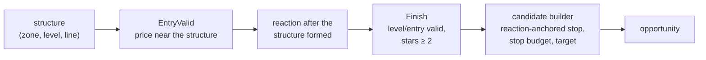

# Strategies

Fifteen independent technical theses. Each has one Go package in
`analysis-engine/internal/strategy/`, one versioned entry under
`analysis.strategies` in `config/analysis.yml` and a specification here. All are
enabled and no instrument contains any of them (`observe_only_strategies: []`
everywhere); the instrument decides how an opportunity trades, never whether a
strategy runs.

A strategy publishes technical opportunities only. It never suppresses, modifies
or waits for another, and never decides which of several overlapping
opportunities trades: Algo Bot correlates them per thesis afterwards
([execution](../execution.md#same-thesis-arbitration)).

## Catalog

| Strategy | Version | Structure | Thesis | Proof | Spec |
|---|---|---|---|---|---|
| `key_level` | v6 | M5 | reaction at a clustered key level in the direction its role implies; on XAU only after the level was swept | `test/keylevelparity` golden | [key_level](key_level.md), [sweep first](keylevel-sweep-first.md) |
| `supply` | v7 | M5 (confirms, executes), M15, H1 (structure) | confirmed rejection of a supply zone with room below; zones touched more than 2 times are spent | `test/supplyv7` | [supply](supply.md) |
| `demand` | v6 | M5, M15, H1 | confirmed bounce from a demand zone; same touch cap | `test/techniqueparity` golden | [demand](demand.md) |
| `order_block` | v7 | M5 (confirms, executes), M15, H1 (structure) | confirmed reaction at the last opposite candle before a displacement that broke structure, with room to the next opposing structure; dead once a close of its own frame goes through its far edge ([order-block-definition](order-block-definition.md)) | `test/obv7` | [order_block](order_block.md) |
| `fvg` | v7 | M5 (confirms, executes), M15, H1 (structure) | confirmed reaction at a real fair value gap, with room and no leg-extreme entry | `test/fvgv7` | [fvg](fvg.md) |
| `ifvg` | v3 | M5 | retest of a fair value gap that lost its role on a measured closing inversion | contract tests, `test/ifvgreplay` | [ifvg](ifvg.md) |
| `crt` | v3 | H1 range, M5 | H1 range, M5 sweep of one edge, reclaim, M5 structure shift | fixtures, `test/crtreplay` | [crt](crt.md) |
| `break_retest` | v3 | M5 | accepted break of its own key level or trendline, fresh retest, rejection | contract tests, `test/brreplay` | [break_retest](break_retest.md) |
| `flip_zone` | v5 | M5 | zone born of an accepted role flip at a key level, confirmed reaction after the break | `test/legacyparity` golden | [flip_zone](flip_zone.md) |
| `trendline` | v6 | M5 | causal trendline with healthy anchors, live interaction, reaction | `test/legacyparity` golden | [trendline](trendline.md) |
| `confluence_zone` | v3 | M5 | two or more genuinely independent structures on one price region, measured rejection | contract tests, `test/czreplay` | [confluence_zone](confluence_zone.md), [spec](confluence-zone-v3-technical-spec.md) |
| `round_number` | v1 | M5 | XAU: stop runs at gold handles (sweep, reclaim, structure shift) and accepted breaks of a handle (retest); one episode per handle and side per day | contract tests, real-capture smoke | [round_number](round_number.md) |
| `asia_range` | v1 | M15 range, M5 | XAU: London's raid of the finalized Asia range (sweep, reclaim, structure shift) or its acceptance (retest); one thesis per edge per day | contract tests, real-capture smoke | [asia_range](asia_range.md) |
| `shock_retest` | v1 | M5 | XAU: the first pullback into the 50 to 61.8 percent retracement of a price-defined volatility shock, rejected in the shock direction (see the open issue in the spec) | contract tests, real-capture smoke | [shock_retest](shock_retest.md) |
| `impulse_pullback` | v3 | M5, M1 | XAU scalp: M5 impulse, corrective pullback to structure, M1 confirmation | `test/scalpparity` (synthetic M1 only) | [impulse_pullback](impulse_pullback.md) |

"Golden" means the decisions and entry reproduce the frozen Python publisher on
committed real captures, generated from the oracle and never from Go. The stop,
the stop budget and the higher-timeframe export differ from those publishers by
design. `ifvg`, `crt`, `break_retest` and `confluence_zone` v3 are deliberate Go
rewrites, not ports: each fixed a defect of its Python version (stops inside the
sweep wick, retests at any age, technique labels counted as independent facts)
with no claim of better outcomes.

## The shared confirmation spine

Every zone, level and line strategy except CRT, iFVG, Break & Retest, Impulse
Pullback, **fvg**, **order_block** and **supply** (v7: each owns its structure, confirmation, room and candidate;
`test/architecture/strategy_ownership_test.go` keeps it off the spine) confirms through
the same code in `internal/strategyutil`:

A rule changed here changes every strategy on the spine at once, so test the spine,
not one strategy × direction cell. The zone part of it is drawn in full in
[Analysis Engine](../analysis-engine.md#confirmed-zone-setups).

## Rules that apply across strategies

| Rule | Applies to | Spec |
|---|---|---|
| Stop beyond the structure and the reaction extreme, plus the ATR buffer | key_level, supply, demand, order_block, fvg, flip_zone, trendline | [reaction-anchored-stop](reaction-anchored-stop.md) |
| Stop wider than the instrument cap is refused, never tightened | the same seven; CRT, Break & Retest, iFVG and Confluence Zone own their equivalent | [legacy-stop-budget](legacy-stop-budget.md) |
| Setup found on M15/H1 structure, confirmed and executed on M5 | supply, demand, order_block, fvg | [htf-zone-structure](htf-zone-structure.md) |
| Sessions, ranges and sweeps are evidence, never strategies | every strategy that cites them | [shared-structure-evidence](shared-structure-evidence.md) |
| The London session's net move in M15 ATR is evidence (`session_momentum_aligned` / `_opposed`), never a gate or a confluence factor | round_number, asia_range, shock_retest, when confirmed in New York | [shared-structure-evidence](shared-structure-evidence.md) |
| Stop wider than the instrument cap is refused, never tightened | round_number, asia_range, shock_retest as well | [legacy-stop-budget](legacy-stop-budget.md) |

## Candidate contract

Every strategy emits a deterministic identity, direction, entry zone, technical
invalidation, targets, machine-readable evidence, strategy-owned quality
components, formation, creation and expiry times, configuration provenance,
causal technical context and a stop envelope. A missing technical fact fails
closed; Algo Bot never rebuilds it. The lifecycle is in
[Analysis Engine](../analysis-engine.md#opportunity-lifecycle).

`Quality.Overall` is informational: it ranks nothing after publication
([acceptance and quality](../analysis-engine.md#acceptance-and-quality)).

## Regenerating goldens

`key_level`, `flip_zone`, `trendline` and the technique strategies read the
detector-contract frame (`internal/legacyread`). Regenerate their golden with
`test/detectorparity/generate_oracle_golden.py` against the frozen oracle, never
from Go output.
