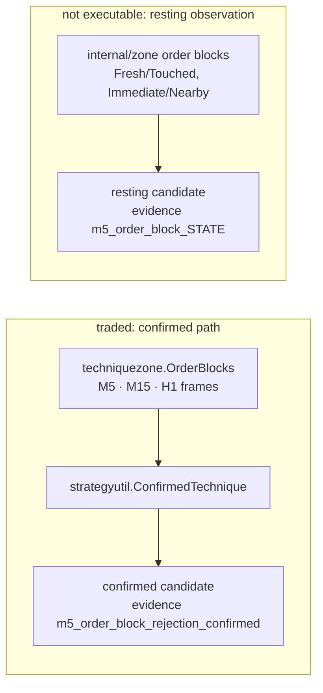
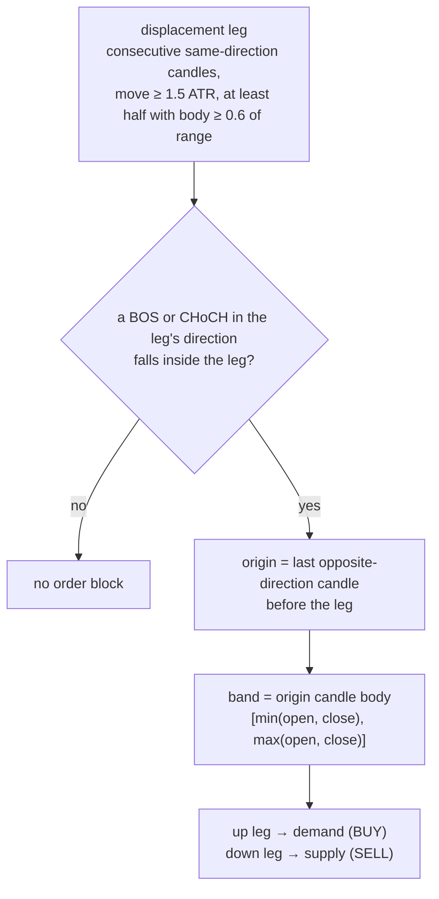
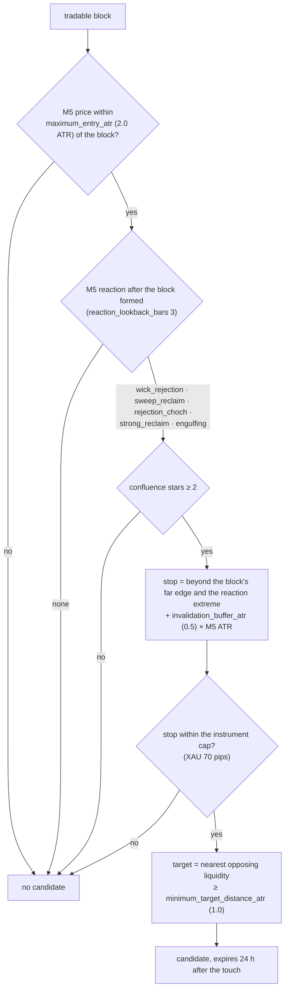

# Order Block

`order_block` `v6`, package `analysis-engine/internal/strategy/orderblock`.
Structure on M5, M15 and H1 (`higher_timeframes: [M15, H1]`); confirmation and
execution on M5. Trades on every instrument.

**Definition (v6, 2026-10-29).** A confirmed block is dead once any close of its own frame after its candle goes beyond its far edge by more than `confirmed_break_buffer_atr` of that frame's ATR (no reclaim forgiveness: a wick that closes back inside is still the sweep), at most `maximum_zone_touches` (2) touches are allowed, and a live opportunity is withdrawn by the first close of its structure's timeframe beyond the structural far edge (`STRUCTURE_CLOSED_THROUGH`). See [order-block-definition](order-block-definition.md).

## Two populations, one is traded

Everything below describes the confirmed path, the one that produces trades.
The resting candidates (`orderblock.resting`) carry no reaction and are never
executed; their lifecycle is the V2 zone book's (`analysis.techniques.*`).

## What an order block is

`techniquezone.OrderBlocks` (`techniquezone.go`) builds them on each frame's own
bars. Touches are counted from the bar after the structure break.

## When it stays tradable

The block is judged on its own frame's bars, with that frame's median ATR over
the 400-bar window:

| Test | Rule (production values) |
|---|---|
| Spent | touched more than `RetestMaxTouches` (30) times |
| Invalidated | a close beyond the far edge by more than `max(pip, 0.05·ATR, 0.5·ATR)` that is not closed back inside within 6 bars, or more than 2 such reclaimed breaks |
| Price at the block | M5 frame only; M15/H1 blocks skip it and let M5 `EntryValid` decide |
| Width | at most 3.0 ATR |
| Origin candle | body at least 0.6 of its range, with a qualifying BOS/CHoCH |
| Closed through (v6) | ANY close of the block's frame after its candle beyond the far edge by more than `confirmed_break_buffer_atr` (0.1) x the ATR at that bar; no reclaim forgiveness |
| Touches (v6) | more than `maximum_zone_touches` (2) |

The first five rows live in `techniquezone.ProductionTechniqueSettings()`, not in
`config/analysis.yml`. For an order block the "reclaimed inside 6 bars counts as a
liquidity sweep" forgiveness of the Invalidated row no longer applies: the v6 rule
is judged on top of it and retires the block on the close (a wick that closes back
inside still is the sweep). The last two rows are strategy-scoped keys under
`strategies.order_block`.

## Confirmation, stop and target

- **Entry**: the proximal slice of the block (`entry_max_width_price`, 5.0 on XAU).
- **Stop**: reaction-anchored ([reaction-anchored-stop](reaction-anchored-stop.md));
  refused above the instrument cap, never tightened; below the floor it carries
  `stop_budget_floor` and execution widens it ([legacy-stop-budget](legacy-stop-budget.md)).
- **Higher timeframes**: an M15/H1 block is bound to M5 by time; the stop covers
  the whole higher-timeframe block ([htf-zone-structure](htf-zone-structure.md)).
- **Selection**: among this strategy's confirmed blocks on one bar, the most stars,
  then the nearest entry.

## Known gaps

From the 28-29 Oct 2026 XAU losses; none is fixed yet.

- **Closes inside the tolerance never break the block.** 0.5 × median ATR is
  about 1.3 points on XAU M5, so repeated closes through the far edge by less than
  that leave the block live.
- **The sweep forgiveness reads closes, not wicks.** Three consecutive closes
  beyond the edge and a 32-point rally were forgiven because price closed back
  inside within 6 bars.
- **No touch cap.** Supply and demand set `maximum_zone_touches: 2`;
  `order_block` does not, so the 30-touch sanity cap applies.
- **The published opportunity outlives the block.** Once published, an
  opportunity ends only on a close beyond its stop level or after 24 h
  ([lifecycle](../analysis-engine.md#opportunity-lifecycle)); a block that later
  closes through does not withdraw it, so a waiting setup can fill hours later.

## Quality and evidence

`Quality.Overall` is the zone-family model (`strategyutil.ZoneFamilyQuality`),
informational only ([quality](../analysis-engine.md#acceptance-and-quality)).
Evidence: `m5_order_block_confirmed`, `m5_order_block_rejection_confirmed`,
`invalidation_beyond_reaction_extreme` when the reaction set the stop,
`stop_budget_structural` / `stop_budget_floor`, `htf_zone_<tf>`.

## Parity

Decisions and entry reproduce the frozen Python `order_block_technique_reaction`
(`test/techniqueparity` golden, 5 symbols). The stop (reaction-anchored), the
stop budget and the higher-timeframe export differ from it by design.
