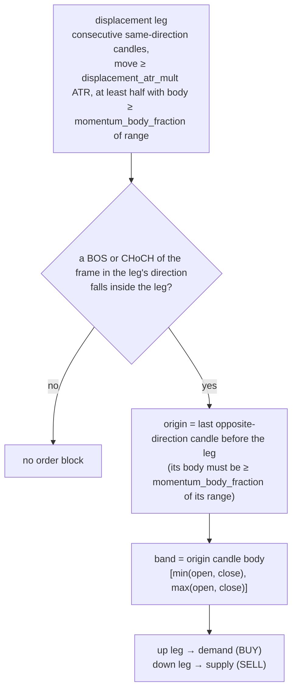

# Order Block (order_block v9)

`order_block`, `v9`. Implemented in `analysis-engine/internal/strategy/orderblock`, self-contained: it reads the closed bars and the facts of the frames in the market context and nothing else (`strategyutil`'s shared confirmation spine, `internal/zone` and `internal/reaction` are not used; `test/architecture/strategy_ownership_test.go` enforces it). Algorithm versions: `structure=v2`, `liquidity=v1`, `zone=v1`, `config=3`. The strategy's whole configuration is `analysis.strategies.order_block`.

**v9 (causal breaks, 31 Oct 2026).** The package computes its structure breaks itself, causally (`breaks.go`), instead of reading the frame's shared ones. A swing joins the reference set only at the bar that confirms it; a break is the first close beyond the most recent confirmed swing of the other side; BOS against CHoCH is judged by the structure of the swings confirmed BEFORE that bar (the shared labelling dates a break up to `fractal_n` bars early and judges its kind by the trend as of the frame's last bar). The same breaks are used for the block's definition, for the `rejection_choch` confirmation on M5 and for the structure score. The kind of the break that formed the block and the sweep before its leg are measured evidence, never a gate ([liquidity-sweep-and-structure](liquidity-sweep-and-structure.md)).

**v8 (candle windows).** A structure stays tradable for as long as its own frame holds it: one whose origin precedes the 150-bar M5 execution window is bound with `OriginIndex` -1, keeps its identity (`StructuralID` and `formed_at` come from the origin bar's time) and has its leg/departure extreme read by time from the structure frame plus the M5 bars since ([analysis-engine-windows](../analysis-engine-windows.md)). Until v7 it was dropped after 12.5 hours. The quality measure `zone_departure_atr` is unknown for such a structure (the M5 bars after its origin are gone).

## Thesis

The last opposite candle before a displacement that broke structure marks where the move began. When M5 trades back into it, rejects it, and there is room to the next opposing structure, the block is defended. The strategy refuses the other cases and says why: a block a structure-frame close went through, and an entry with no room in front of it.

## Structure (`structure.go`)

M5 never defines a block. `structure_timeframes: [M15, H1]` names the frames a block is found on; each is judged on its own bars and its own ATR.

A block stays tradable while it is: not spent (touched more than 30 times, or invalidated: a close beyond the far edge by more than 0.5 ATR that is not reclaimed within 6 bars, or more than 2 reclaimed breaks); at most `maximum_zone_atr` of its frame's ATR wide; not closed through (`ob_closed_through`: ANY close of its own frame after its candle beyond the far edge by more than `confirmed_break_buffer_atr` of that bar's ATR, no reclaim forgiveness: a wick that closes back inside is the sweep, a close is the break); and touched no more than `maximum_zone_touches` (2) times. The entry band is the block's proximal slice, clipped to `entry_max_width_price`. A block only exists from the close of the structure-frame candle at which its break became knowable (the breaking close, which is never before the confirmation of the swing it broke): a touch before that is its formation, not a reaction.

The block is bound to the M5 frame by time: its first touchable M5 bar is the first one opening at or after the close of the structure candle that confirmed it.

## Confirmation (`confirm.go`)

Unchanged from v6, and owned here: after a touch of the entry band, within `reaction_lookback_bars` (3), one of `wick_rejection`, `sweep_reclaim`, `rejection_choch`, `strong_reclaim`, `engulfing` (`engulfing_minimum_range_atr` x the M5 ATR). The candidate's `Reaction` carries the touch and confirmation bar times, `ReactionType "rejection"` and the pattern.

## Entry, stop, room, target (`decision.go`, `candidate.go`, `geometry.go`)

- **Entry**: price at the band or within `maximum_entry_atr` x the M5 ATR of its proximal edge, not through it.
- **Stop**: beyond the whole block and beyond the extreme of the M5 bars from the touch to the confirmation, plus `invalidation_buffer_atr` x the M5 ATR (`invalidation_beyond_reaction_extreme` when the reaction's extreme set it). Over the instrument stop cap it is refused, never tightened; `stop_budget_floor` below the floor ([legacy-stop-budget](legacy-stop-budget.md)).
- **Room**: the obstacles in front of the entry, nearest first, are (a) every confirmed fractal swing (`obstacle_pivot_bars` bars on each side, causal: a pivot is known only once its right-hand bars have closed) on M5 and on the structure frame that no M5 close has gone through since it was known, and (b) the extreme of the displacement leg that broke structure, from the leg's first candle to the decision bar. The nearest obstacle is the target (`nearest_opposing_structure`) when it is at least `minimum_target_r` x the risk away; closer, the entry has no room and is refused (`no_target_room`). With no obstacle the target is `fallback_target_r` x the risk (`fixed_reward_risk`).
- **No extension rule**: a block sits at the origin of its leg, so the entry is the leg's retracement by construction.
- **Selection**: among this strategy's confirmed blocks on one bar, the most stars, then the nearest entry.

## Qualification and evidence

The shared confluence rubric (stars, floor `confluence_floor`) with factors the confirmation measurably showed (the wick, the engulfing body, a reclaim, a change of character, the higher timeframe bias, the block's touches, a fibonacci touch). Evidence codes: `m5_order_block_confirmed`, `m5_order_block_rejection_confirmed`, `htf_zone_<tf>`, `invalidation_beyond_reaction_extreme`, the stop budget code; v9 adds `m5_order_block_break_bos` / `m5_order_block_break_choch` (the kind of the causal break that formed the block, judged by the structure as of that bar) and `m5_order_block_prior_sweep_<swing|pdl|pdh|session>` (a bar from `sweep_lookback_bars` before the leg's first candle through that candle traded through a level of resting liquidity; the same test as fvg's, this package's own copy). Neither is a confluence factor. Quality (informational, never a gate): the zone-family dimensions plus the measure `room_r`, and from v9 `break_kind` (1 BOS, -1 CHoCH), `prior_sweep` (0/1) and `sweep_depth_atr`. Nothing reads them to rank or refuse; the research found no benefit in either for order blocks.

## Refusals

`strategy_refused{symbol, strategy="order_block", structure_timeframe, reason}` (a Go counter; `reason` is `ob_closed_through` or `no_target_room`). A structure is counted once per evaluation; the counter never blocks one. It replaces `ob_definition_refused`. `strategy_feature{symbol, strategy, structure_timeframe, feature, value}` counts, per created opportunity, `prior_sweep` (0/1) and `break_kind` (bos/choch).

## Lifecycle of a published block (engine, unchanged)

A live opportunity is withdrawn by the first close of its structure's timeframe beyond the structural far edge by `confirmed_break_buffer_atr` (`STRUCTURE_CLOSED_THROUGH`, rule C of [order-block-definition](order-block-definition.md)). The engine reads the same `confirmed_break_buffer_atr` key as the strategy.

## Configuration

Every key of `analysis.strategies.order_block` has a consumer in the package and every key the package reads is there; the engine injects only the instrument scale (`pip_size`, `entry_max_width_price`, the stop envelope) and the shared confluence rubric. `minimum_strength`, `minimum_zone_atr` (both read only by the deleted resting path) and `minimum_target_distance_atr` (replaced by `minimum_target_r`) of v6 are gone; `higher_timeframes` became `structure_timeframes`.

## Measured against v6

See the pull request that introduced v7: commit A moved the code and was proven identical to master by replay; commit B changed behaviour. The 28-29 Oct 2026 production blocks (three losing XAU blocks, one winning EURUSD block) are all M5 blocks: v5 (what production ran) publishes all four, v6 refuses two of the losers, v7 publishes none of the three losers (`test/obv7`). The figures are publish counts, not profit: no capture here knows what a published setup went on to do.

## History

- v3-v5: reaction-anchored stop, instrument stop budget, M15/H1 structure ([reaction-anchored-stop](reaction-anchored-stop.md), [legacy-stop-budget](legacy-stop-budget.md), [htf-zone-structure](htf-zone-structure.md)).
- v6 (production 28-29 Oct 2026): the close-break rule and the touch limit ([order-block-definition](order-block-definition.md)).
- v7: the package owns its mechanism; M15/H1 structure only; room refusal.
- v8: a structure older than the M5 execution window stays tradable ([analysis-engine-windows](../analysis-engine-windows.md)).
- v9: causal structure breaks owned by the package; break kind and prior sweep as measured evidence ([liquidity-sweep-and-structure](liquidity-sweep-and-structure.md)). Rollback: revert the version.

## Release

Deploy the Python bot first (or together with Go). If `config/analysis.yml` is rendered from `st-mich43l/ansible-library`, the `strategies.order_block` block changed shape (`higher_timeframes` -> `structure_timeframes`, new keys, three removed); that repository was not edited. Opportunity ids change once at deploy (the strategy version is part of the id).
